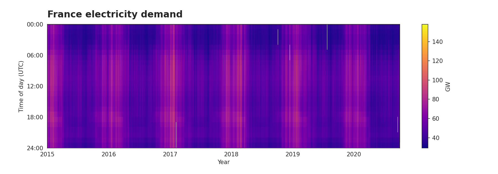
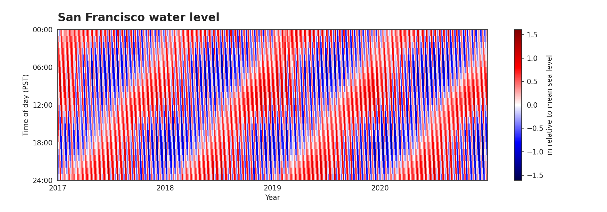

# Solar Data Tools User Guide

This guide serves as a reference for the typical Solar Data Tools user. We will go over the main
user-facing classes and methods, with examples and relevant details for you to get started. As you
will see, most of the methods in Solar Data Tools are automated, so you can get started with minimal
effort and very little input from your side.

For a more comprehensive list of all methods and functions, you can check the [API reference](index_api_reference.rst).
**However, this user guide likely provides you with all the functionality you need, while the rest of
the functions listed in the API reference are more internal/helper functions that were not meant for
users to interact with.**

If any part of this guide is unclear, or you'd like
to improve on these docs, please consider [submitting an Issue or a PR](index_dev.md)!

## Getting started with the `DataHandler` class
Most users will only need to interact with the `DataHandler` class. To instantiate, a Data Handler
object takes a DataFrame containing the power data timeseries (with a timestamps and power columns)
as an input. Note that the DataFrame must have a DatetimeIndex, or the user must set the `datetime_col` kwarg.

Supply timestamps in the site's local standard time. The pipeline warns when
recurring production near midnight suggests a possible timezone misalignment.

Let's say we have a CSV file with power data that we want to analyze. We can load it into a DataFrame:

```python
import pandas as pd
from solardatatools import DataHandler

df = pd.read_csv('path/to/your/data.csv')
```
Then we can create a DataHandler object with this DataFrame:

```python
dh = DataHandler(df)
```

If you know that your data is affected by daylight savings, you can run the following method to correct
for it:

```python
dh.fix_dst()
```

The DataHandler object is now ready to be used for data processing and analysis.

### A note on long-form vs. wide-form data

Timeseries data is often in wide-form, where you have for example a DataFrame that has a timestamp
column and one or more data columns. That's what the DataHandler typically expects. However,
it also can take data in long-form, such as for example what we have in the Redshift data where some sites
have more than one inverter. In this case, you will
want to instantiate the DataHandler object with the `convert_to_ts` flag set to True:

```python
dh = DataHandler(df, convert_to_ts=True)
```

This prompts the DataHandler to convert the data to wide-form before running the pipeline, given
default index and column names intended to work with GISMo's VADER Cassandra database implementation
(see `solardatatools.time_axis_manipulation.make_time_series`).

For more information on long-form vs. wide-form, you can check out [this nice writeup](https://seaborn.pydata.org/tutorial/data_structure.html#long-form-vs-wide-form-data) from
the Seaborn documentation.

## Running the pipeline
The `DataHandler.run_pipeline` method is the main data processing and analysis pipeline offered by
Solar Data Tools. It includes preprocessing, cleaning (e.g. fixing time shifts), and scoring data
quality metrics (e.g. finding clear days, capacity changes and any clipping.

To run the pipeline, simply call the method:

```python
dh.run_pipeline()
```

This method can be passed a number of optional arguments to customize the pipeline. For example, you may
need to specify the timezone of the data, or the solver to use for the capacity change detection.
Most commonly, you will want to specify the power column name and whether to run a
timeshift correction. Here is an example of how to run the pipeline with these arguments:

```python
dh.run_pipeline(power_col='power', fix_shifts=True)
```

Note that the pipeline can take a while to run, depending on the size of the dataset and the solver
you are using (from a couple of seconds up to a minute).

Once the pipeline is run, the DataHandler object will have a number of attributes that you can access
to view the results of the analysis. The top-level report is accessed by calling the `report` attribute:

```python
dh.report()
```

This will print a summary of the results of the pipeline, including the data quality metrics.
We can also make a machine-readable version, which is useful when processing many files/columns
for creating a summary table of all data sets.

```python
dh.report(return_values=True, verbose=False)
```

After a partial run, the report keeps the metrics that are available and uses
`None` for unavailable results. For example, `time shift correction` is
`False` when a successful fit finds no shift and `None` when the fit fails
or was not requested. The `stage outcomes` mapping records each stage's
status, reason, and elapsed seconds. A usable fallback includes the reason
it was used. Dask includes the same outcomes in its per-key report and
writes them as JSON in the CSV output.

Every call to `run_pipeline()` starts a fresh result attempt. Source data
and explicit input preprocessing, such as `fix_dst()`, carry forward to the
next attempt. If daylight estimation fails after observations are prepared,
`dh.plot_heatmap(matrix="raw")` is still available for inspecting the data.

### Sampling intervals and timestamp snapping

Use an exact fixed sampling interval that divides a 24-hour day, such as
`sampling_interval="500ms"` or `sampling_interval="90s"`. When omitted,
`run_pipeline` and `standardize_time_axis` use fixed frequency metadata or
infer a clear cadence from the timestamps. For mixed or ambiguous spacings,
provide the interval or split the record. Supply local standard time and
normalize timezone-aware data that span an offset change before processing.

For jittered input, inference looks for one supported cadence with at least
three adjacent gaps and a strict majority of gaps within 2% of that cadence.
The median displacement from the midnight grid must also be within a quarter
of the cadence. A sustained run of similar gaps at another spacing requires
an explicit interval or a split record.

Each source row can fill its nearest grid slot within `snap_tolerance`,
which defaults to half the interval, inclusive. A halfway tie goes to the
earlier slot. When rows compete for a slot, the closest whole row wins, with
source order breaking ties. Omitted slots and the unobserved parts of partial
days are NaN. A final accepted snap to the following midnight adds that date
to the grid. `make_2d` embeds aligned data and retains its explicit day trim
options and its trimming of fully missing edge days for the selected column.

`standardize_time_axis(..., return_diagnostics=True)` returns
`(frame, 0, diagnostics)` with the resolved interval and the rejected and
colliding source rows, identified by zero-based input position. With the
default, the return remains `(frame, 0)`. `DataHandler` retains the diagnostics
as `time_axis_diagnostics`. The report's `timestamp rejection count` includes
collision losers, and `timestamp collision count` counts affected grid slots.
These counts describe standardization before analysis-day selection. The
report's `sampling` stays in minutes, including fractional minutes.

### Power and energy units

`run_pipeline` assumes watts unless you specify `units="kW"`. If your
input was already in kilowatts and relied on the old magnitude heuristic,
pass `units="kW"` explicitly. `capacity_estimate` uses the declared input
unit, and `daily_signals.energy` uses `dh.energy_units`, Wh for W input and
kWh for kW input. The report's `capacity` field remains in kW, and
loss-factor report fields labeled `[kWh]` remain in kWh.

`plot_daily_energy()` and the loss-factor waterfall use the stored energy
unit by default. Pass `units="Wh"` or `units="kWh"` to convert for display.
Bundt plots display electrical power in kW by default and accept `units="W"`.
Direct `LossFactorAnalysis` calls assume kWh and accept `energy_units="Wh"`
for Wh input. Loss attributes use that input unit.

Custom signal labels such as `units="W/m²"` are preserved for analysis and
plotting. The daily integral carries the signal unit times hours. For custom
labels the machine-readable electrical `capacity` field is `None`, and loss
factor analysis requires input declared in W or kW. For clear-sky detection
with a custom label, call `detect_clear_sky(loss_correction=False)`.

## Plotting some pipeline results

The DataHandler object has a number of plotting methods that can be used to visualize the results of
the pipeline. Here is a full list of the plotting methods available after running the main pipeline:
| Method | Description|
| --- | --- |
|    DataHandler.plot_heatmap | Plot a heatmap of the data |
|    DataHandler.plot_bundt | Make a "[Bundt plot](https://ieeexplore.ieee.org/abstract/document/10749393)" of the data |
|    DataHandler.plot_circ_dist | Plot the circular distribution of the data |
|    DataHandler.plot_daily_energy | Plot the daily energy |
|    DataHandler.plot_daily_signals | Plot the daily signals |
|    DataHandler.plot_density_signal | Plot the density signal |
|    DataHandler.plot_data_quality_scatter | Plot the data quality scatter |
|    DataHandler.plot_capacity_change_analysis | Plot the capacity change analysis |
|    DataHandler.plot_time_shift_analysis_results | Plot the time shift analysis results |
|    DataHandler.plot_clipping | Plot the clipping |
|    DataHandler.plot_cdf_analysis | Plot the CDF analysis |
|    DataHandler.plot_daily_max_cdf_and_pdf | Plot the daily max CDF and PDF |
|    DataHandler.plot_polar_transform | Plot the polar transform |

Note that the timeshift correction method must be run (by passing `fix_shifts=True` to `run_pipeline`)
before calling the `plot_time_shift_analysis_results` method.

### Clock frames after relative time-shift correction

`run_pipeline(fix_shifts=True)` uses the selected time-shift model.
Set `periodic_detector=True` to require exact 365-day recurrence of the
clock-shift component.

`raw_data_matrix` and `boolean_masks.missing_values` stay on the observation
clock, the standardized grid before relative correction.
`corrected_observed_matrix` applies the relative correction to observations and
their NaNs. Time dilation, PV quantile fitting, and Bundt plots use those
observations with daylight bounds on the same corrected clock. In `PVQuantiles`,
`sig_original` and `quantiles_original` refer to the regular sampling grid on
the corrected clock. Undilation restores that grid and preserves the clock
correction. Fitted quantiles can be defined where observations are missing.

`augment_data_frame` exports sub-daily masks to observation timestamps. Its
default `input_clock="corrected"` reverses the applied relative correction. For
an observation-clock mask, pass `input_clock="observation"`, for example
`dh.augment_data_frame(dh.boolean_masks.missing_values, "missing", input_clock="observation")`.
Daily masks use dates in either case.

### Timezone advisory and migration

`run_pipeline` checks observed values before filling and relative clock
correction. It warns when power exceeds 5% of the 95th percentile of positive
observations within an hour of midnight on at least three midnights and at
least 10% of eligible midnights. A midnight is eligible when at least half the
expected samples in each of `[23:00, 24:00)` and `[00:00, 01:00)` are finite.
For timestamped input, the check counts a grid sample only if its source
observation is less than half a sampling interval away.
The report field `possible timezone misalignment` is `True` for a warning,
`False` when the check finds no evidence, and `None` when the check is
unassessed due to insufficient coverage or lack of a positive reference.
Daylight estimates and daily analyses can be unreliable when production
crosses midnight. Check the source timezone and localize explicitly if needed.
If later pipeline stages cannot produce a report, the advisory remains
available on `dh.possible_timezone_misalignment`. Use
`dh.plot_heatmap(matrix="raw")` to inspect the observations and their gaps
even if the daylight analysis cannot proceed.

Omit the deprecated `correct_tz` argument. During the transition, both
boolean values are accepted and neither shifts the data or controls the
advisory. `standardize_time_axis` still returns `(frame, 0)`, and the legacy
`time zone correction` report field is always zero.

Examples of some of these plotting methods are shown below in the notebooks and examples section,
such as the [demo](getting_started/notebooks/demo_default.nblink) and the
[tutorial](getting_started/notebooks/tutorial.ipynb).

## Plotting a generic time series

The top-level `plot_heatmap` function standardizes timestamps and plots one
column per day, with missing samples left blank. Pass a pandas Series or a
DataFrame with a `DatetimeIndex`. For a DataFrame with multiple columns, use
`key` to select the signal. The optional `units` argument labels the colorbar.
Nonnegative data use `plasma`. If any plotted value is negative, the function
uses `seismic` with symmetric limits around zero.

Run this shared setup before the examples. The formatter adds titles, time
zone labels, and year ticks to the returned Matplotlib figures.

```python
from urllib.parse import urlencode

import matplotlib.dates as mdates
import pandas as pd

from solardatatools import plot_heatmap


def label_heatmap(fig, title, clock):
    fig.subplots_adjust(left=0.095, bottom=0.15, top=0.86, right=0.98)
    ax = fig.axes[0]
    ax.set_title(title, loc="left", fontweight="bold", fontsize=16, pad=12)
    ax.set_ylabel(f"Time of day ({clock})")
    ax.xaxis.set_major_locator(mdates.YearLocator(tz="UTC"))
    ax.xaxis.set_major_formatter(mdates.DateFormatter("%Y", tz="UTC"))
    ax.set_xlabel("Year")
```

### France electricity demand (nonnegative)

Hourly demand from January 2015 through September 2020 shows higher winter
demand and a recurring evening peak. The color scale includes one reported
158 GW reading. The next-highest reading is 94.5 GW.
[Open Power System Data, 2020-10-06 release](https://data.open-power-system-data.org/time_series/2020-10-06)



```python
url = (
    "https://data.open-power-system-data.org/time_series/2020-10-06/"
    "time_series_60min_singleindex.csv"
)
load_key = "FR_load_actual_entsoe_transparency"
power = pd.read_csv(url, usecols=["utc_timestamp", load_key])
power.index = pd.to_datetime(power["utc_timestamp"], utc=True)
load_gw = power[load_key].dropna() / 1000

fig = plot_heatmap(load_gw, sampling_interval="1h", units="GW", figsize=(12, 4.2))
label_heatmap(fig, "France electricity demand", "UTC")
fig.savefig("france-electricity-demand.png", dpi=150, facecolor="white")
```

### San Francisco water level (signed)

Verified hourly readings from 2017 through 2020 show high and low tides
shifting through the day. Zero is mean sea level, with red above it and blue
below it. The API returns timestamps in Pacific Standard Time throughout
the year when requested with `time_zone="lst"`.
[NOAA tide gauge 9414290](https://tidesandcurrents.noaa.gov/stationhome.html?id=9414290) ·
[NOAA data API](https://api.tidesandcurrents.noaa.gov/api/dev/)



```python
api = "https://api.tidesandcurrents.noaa.gov/api/prod/datagetter"
annual_heights = []
for year in range(2017, 2021):
    query = urlencode(
        {
            "begin_date": f"{year}0101",
            "end_date": f"{year}1231",
            "station": "9414290",
            "product": "hourly_height",
            "datum": "MSL",
            "time_zone": "lst",
            "units": "metric",
            "application": "solar-data-tools",
            "format": "csv",
        }
    )
    annual = pd.read_csv(f"{api}?{query}", skipinitialspace=True)
    annual.index = pd.to_datetime(annual["Date Time"])
    annual_heights.append(annual["Water Level"])

height_m = pd.concat(annual_heights)
fig = plot_heatmap(
    height_m,
    sampling_interval="1h",
    units="m relative to mean sea level",
    figsize=(12, 4.2),
)
label_heatmap(fig, "San Francisco water level", "PST")
fig.savefig("san-francisco-water-level.png", dpi=150, facecolor="white")
```

## Running loss factor analysis

Once the main pipeline is run, you can run the loss factor analysis to estimate the loss factor of
the system. This is done by calling the `run_loss_factor_analysis` method:

```python
dh.run_loss_factor_analysis()
```

This method will estimate the loss factor of the system by running a Monte Carlo sampling to generate
a distributional estimate of the degradation rate. The results are stored in `dh.loss_analysis`.

Once it terminates, you can visualize some of the results by calling the following functions:

| Method                                     | Description                                                         |
|--------------------------------------------|---------------------------------------------------------------------|
| DataHandler.loss_analysis.loss_analysis.plot_pie | Create a pie plot to visualize the breakdown of energy loss factors |
| DataHandler.loss_analysis.plot_waterfall   | Create waterfall plot to visualize the breakdown of energy loss factors |
| DataHandler.loss_analysis.plot_decomposition   | Plot the estimated signal components found through decomposition    |

Head over to our [demo](getting_started/notebooks/demo_default.nblink) and
[tutorial](getting_started/notebooks/tutorial.ipynb) to see these functions in action on real data.

## Running clear sky model estimation

After the main pipeline is run, a clear sky model of the PV system power can be estimated by running:
```python
dh.fit_statistical_clear_sky_model()
```
This fits a *smooth, multiperiodic* model of the instantaneous 90th percentile of the power data, as explained in [this paper](https://ieeexplore.ieee.org/abstract/document/10749393). Under the hood, this invokes the [spcqe package](https://github.com/cvxgrp/spcqe). Check out this [demo](getting_started/notebooks/clearsky_estimation_demo.nblink) for more information.

## Running clear sky data labeling

The clear sky labeling subroutine leverages the results from the main pipeline, the loss factor estimation, and the clear sky model fitting, all described above. After the main pipeline is run, the user may run:
```python
dh.detect_clear_sky()
```
If either or both of the loss factor estimation and clear sky estimation modules have not been run, the Data Handler will run those modules automatically when `detect_clear_sky` is called. (The Data Handler will not re-run these modules if they've already been invoked and will just make use of the outputs.)

Check out this [demo](getting_started/notebooks/clearsky_detection_demo.nblink) for more details.

## Other features

### Orientation and Location estimation
The DataHandler also includes methods to estimate the position of the solar panels based on the data.
This includes the location (latitude and longitude) and orientation (tilt and azimuth) of the system.
The available methods are:

| Method                                                | Description                                                                       |
|-------------------------------------------------------|-----------------------------------------------------------------------------------|
| DataHandler.setup_location_and_orientation_estimation | Sets up the location and orientation estimation for the system given a GMT offset |
| DataHandler.estimate_latitude                         | Estimates latitude                                                                |
| DataHandler.estimate_longitude                        | Estimates longitude                                                               |
| DataHandler.estimate_location_and_orientation         | Estimates latitude, longitude, tilt and azimuth                                   |
| DataHandler.estimate_orientation         | Estimates tilt and azimuth                                                        |

To call the estimation methods, first you need to run the `setup_location_and_orientation_estimation``
method and provide a GMT offset value by passing it to the method. After that, you can call any of the
four estimation methods. A demo of this feature can be found in the [tutorial](getting_started/notebooks/tutorial.ipynb)
in cells 13-15.

### Loading data

You can load data into a DataFrame using standard pandas functions:

```python
import pandas as pd

df = pd.read_csv('path/to/your/data.csv', index_col=0, parse_dates=True)
```
